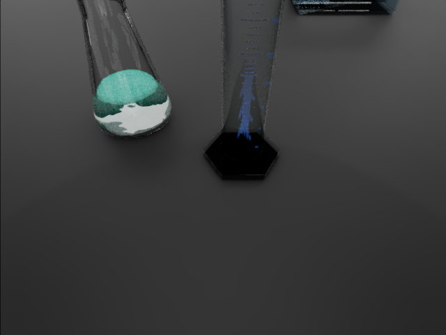
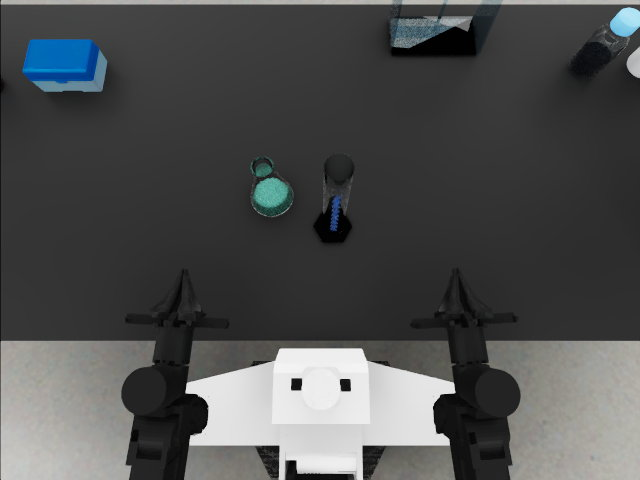
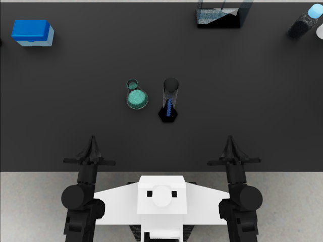
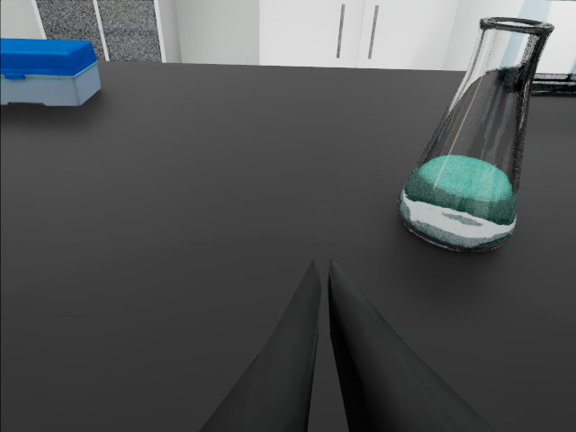
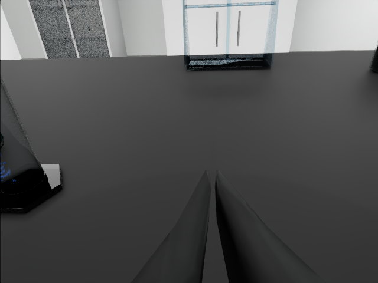

# WET-OP 本地服务

本次封版包含应用代码和任务配置；Docker 镜像构建与虚拟环境暂不提交。以下命令基于当前 wetop-server 容器。

场景、任务文件结构和新增任务方法见 [app/README.md](app/README.md)。

以下命令在 `wetop-server` 容器内执行。项目目录：`/cluster/hdd/czs/projects/WetOPServer`。每个需要直接运行 `python` 的终端，先激活项目虚拟环境：

```bash
cd /cluster/hdd/czs/projects/WetOPServer
source .venv/bin/activate
python -V  # Python 3.10.14
```

`.venv` 使用 Isaac Sim 自带的 Python，已登记 `/opt/wetop` 的依赖与项目 GenManip 源码；不需要手动设置 `PYTHONPATH`。容器启动后只运行 SSH，仿真服务需要手动启动。

## 1. 启动 server

终端 A：

```bash
cd /cluster/hdd/czs/projects/WetOPServer
bash app/ray_server.sh
```

保持终端 A 运行。服务地址为 `http://127.0.0.1:18087`。脚本会让 Isaac Sim 的 `python.sh` 使用项目 `.venv` 解释器，以加载仿真所需的 Kit 环境。

## 2. 加载任务

终端 B，加载当前公开可运行的 `task_01_pour_flask_to_cylinder`：

```bash
cd /cluster/hdd/czs/projects/WetOPServer
bash app/task01_submit.sh
```

`submit` 返回 `IDLE`、进度 0% 是正常的：任务已加载，等待 SDK 调用 `reset()`。当前工程只有这个任务的可运行 YAML 和公开 seed。

添加其他任务的 YAML 后，用官方 CLI 加载，路径相对于 `app/configs/tasks/`：

```bash
cd /cluster/hdd/czs/projects/WetOPServer/app
source ../.venv/bin/activate
python -m genmanip_client submit \
  scientific_experiments/<任务名>/<划分>/<配置>.yml \
  --host 127.0.0.1 --port 18087 --run_id <本次运行名>
```

例如当前脚本实际提交的是 `scientific_experiments/task_01_pour_flask_to_cylinder/validation/mixed/mixed_1.yml`，运行名为 `wetop_task_01`。切换任务时提交另一个 YAML，然后新建 SDK client 并调用 `reset()`；`EvalClient` 没有“选择任务”参数。

## 3. SDK：reset、读取观测、step

在终端 B 执行下面的完整示例。三段调用在同一个 Python 进程中顺序运行；`step()` 必须在 `reset()` 之后。`fake_action` 只用于接口调试，实际策略应替换成自己的动作。

```bash
cd /cluster/hdd/czs/projects/WetOPServer
source .venv/bin/activate
python - <<'PY'
from genmanip_client import EvalClient, fake_action

client = EvalClient(
    "http://127.0.0.1:18087",
    worker_ids=["0"],
    run_id="wetop_task_01",
    save_result=False,
    save_process=False,
    reset_timeout=3000,
    step_timeout=600,
)
try:
    # reset：重置环境，并返回初始观测
    result = client.reset()

    # 读取观测：SDK 没有单独的 get_obs()；reset 和 step 都返回 obs
    obs = result["0"]["obs"]
    print("instruction:", obs["instruction"])
    print("joints:", obs["state.joints"])
    print("gripper:", obs["state.gripper"])
    print("base:", obs["state.base"])
    for name, frame in obs.items():
        if name.startswith("video."):
            print(name, frame.shape)  # 四路相机图像

    # step：给 worker 0 发送一帧示例双臂动作，并读取新观测
    action = fake_action("r5a", "lift2", "joint_position")
    result, done = client.step({"0": action})
    next_obs = result["0"]["obs"]
    print("done:", done)
    print("next joints:", next_obs["state.joints"])
finally:
    client.close()
PY
```

仅检查 `reset()` 和四路图像、不执行动作，可运行现有示例：

```bash
cd /cluster/hdd/czs/projects/WetOPServer
source .venv/bin/activate
python sdk_debug.py
```

需要让该示例再执行一次 `step()` 时，追加 `--step`。图像写入 `client_results/sdk_debug/`。目前只对公开 task_01 的 seed `000` 完成过完整 `reset()`，返回四路 480×640 观测；`step()` 已完成一帧接口测试。

## Task 01 调试样例：同一初态的 reset 与单步 step

以下图片来自公开的 `task_01_pour_flask_to_cylinder`、seed `000` 的同一次 SDK 运行。`reset()` 返回指令、双臂关节与夹爪状态，以及四路 640×480 RGB；随后发送 `fake_action("r5a", "lift2", "joint_position")` 做一次接口测试。该动作仅用于验证 `step()`，`done=False`，不代表完成倒液任务。此次 `reset()` 用时 111.95 秒，单次 `step()` 往返用时 0.216 秒。[查看完整终端记录](docs/task01-debug/receipt.txt)。

| 视角 | reset 后 | 单步 step 后 |
| --- | --- | --- |
| 顶部 |  |  |
| 俯视 |  |  |
| 左侧 |  |  |
| 右侧 |  |  |
